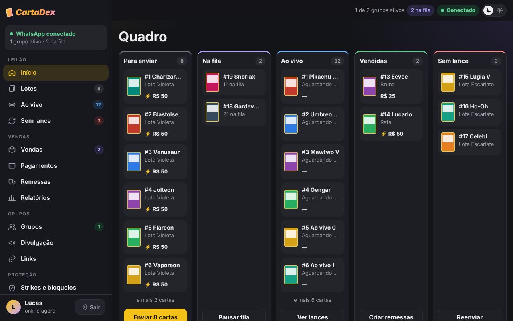
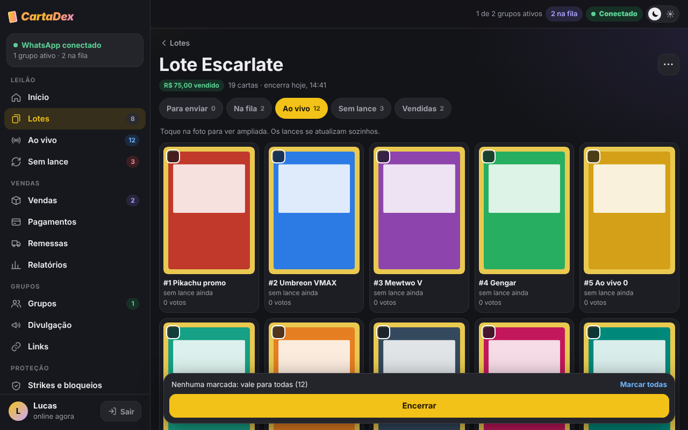
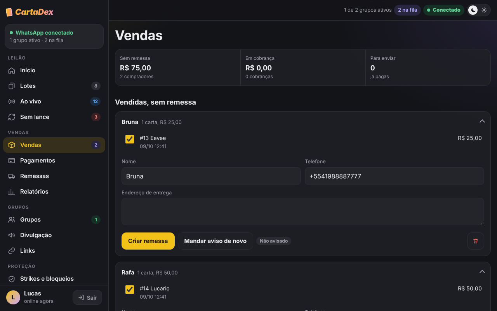
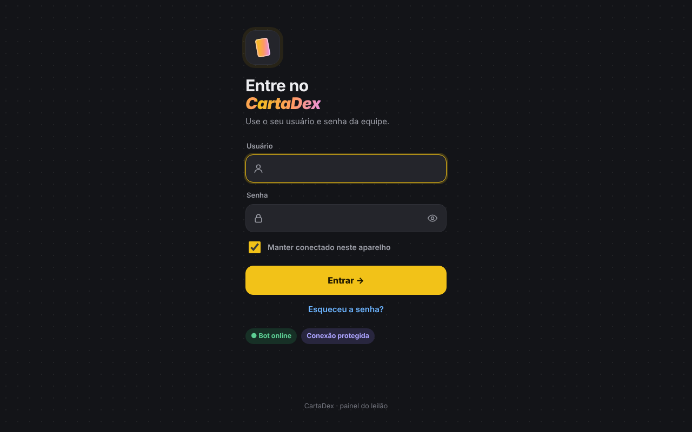
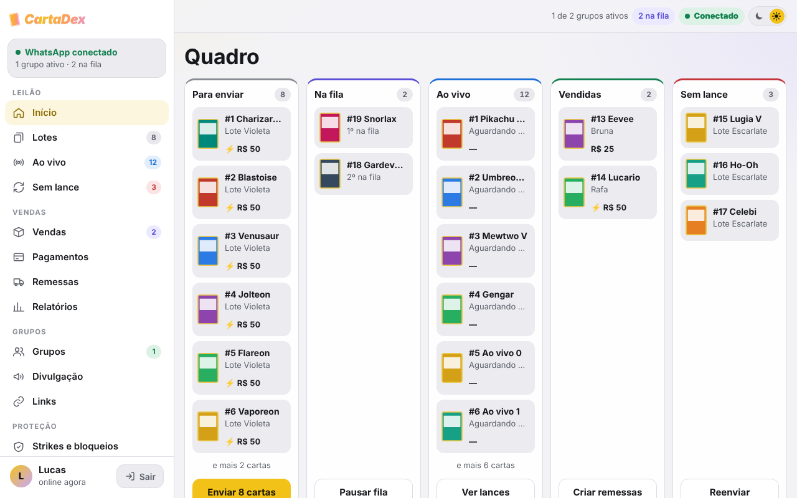
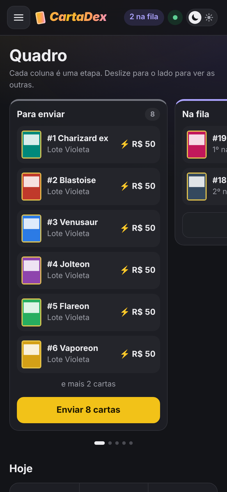

# Cartadex hNX

Sistema que automatiza leilões de cartas colecionáveis em grupos de WhatsApp. Ele junta um bot, que posta as cartas e lê os lances, e um painel web, onde os administradores cuidam de todo o processo: do cadastro das cartas até a entrega ao comprador.

O projeto está em uso real por um grupo de vendas de cartas.



## O problema

Antes, cada leilão era feito à mão: postar a foto de cada carta, acompanhar os lances nas mensagens, descobrir quem ganhou, cobrar cada comprador, conferir se o pagamento caiu e avisar sobre o envio. Com dezenas de cartas por leilão, isso tomava horas e gerava erros.

## O que o sistema faz

**Leilão**
- Cadastro de cartas em lotes (várias fotos de uma vez, cada foto vira uma carta)
- Envio em fila para um ou mais grupos: foto da carta e, logo abaixo, uma enquete com 3 lances e um valor de arremate
- Envio na hora ou agendado, com encerramento automático
- Apuração do vencedor: vence o maior lance ou o arremate; em caso de empate, vence quem votou primeiro
- Votos dados depois da hora de encerrar, ou que chegam fora de ordem, são ignorados
- Anúncio do resultado no grupo, marcando os ganhadores

**Vendas**
- Mensagem no privado para cada ganhador, com as cartas e o link de pagamento
- Cobrança pelo Mercado Pago (Pix e cartão), com confirmação na hora por webhook e conferência automática como reserva
- Código Pix com validade de 5 minutos e aviso de pagamento em dobro
- Lembretes de pagamento nos horários escolhidos, até o pagamento cair
- Remessas com acompanhamento do código de rastreio e aviso ao comprador a cada etapa da entrega
- Relatórios de vendas por período, por lote e por comprador

**Administração e segurança**
- Painel com login para vários administradores e registro de tudo o que cada um faz
- Senhas guardadas com hash (scrypt), limite de tentativas de login e recuperação de senha por código enviado no WhatsApp
- Proteção dos grupos: bloqueio de links, verificação de membros suspeitos, strikes para quem retira lance depois do prazo
- Backup diário do banco de dados no Google Drive e cópia automática antes de qualquer exclusão
- Monitoramento: o bot manda um sinal de "estou vivo" a cada minuto para um serviço externo, que avisa se ele cair, se o WhatsApp desconectar ou se o túnel parar
- Painel em tempo real (Server-Sent Events): lances, pagamentos e remessas aparecem sem recarregar a página
- Tema claro e escuro, e layout que funciona no celular

## Telas

| Página de um lote | Vendas por comprador |
|---|---|
|  |  |

| Login | Tema claro | Celular |
|---|---|---|
|  |  |  |

*As telas usam dados de demonstração.*

## Tecnologias

- **Node.js 22** e **JavaScript** (módulos ES)
- **SQLite** pelo módulo nativo `node:sqlite`
- **Express** para o painel web, com HTML gerado no servidor
- **Baileys** para a conexão com o WhatsApp
- **APIs REST**: Mercado Pago (pagamentos) e PacoteVício (rastreio de encomendas)
- **Linux** e **systemd** para rodar em um servidor próprio
- **Cloudflare Tunnel** e **Cloudflare Access** para acessar o painel de fora de casa com HTTPS e login por e-mail, sem abrir portas no roteador
- **rclone** para os backups no Google Drive
- **node:test** para os testes automatizados

## Como o código está organizado

```
src/
  index.js        ponto de partida: liga o WhatsApp, a fila e o painel
  whatsapp.js     conexão com o WhatsApp, envio de mensagens e leitura dos votos
  votos.js        decifra os votos das enquetes e transforma em lances
  leilao.js       regras do leilão: opções da enquete e apuração do vencedor
  fila.js         fila de envio, agendamentos, encerramentos e divulgação
  cobranca.js     cobranças, conferência de pagamento e lembretes
  mercadopago.js  integração com a API do Mercado Pago
  rastreio.js     acompanhamento das entregas
  painel.js       rotas do painel web
  paginas.js      HTML das páginas
  sessao.js       login, sessões e recuperação de senha
  backup.js       backups locais e no Google Drive
  monitor.js      sinal de "estou vivo" para o aviso de fora do ar
  db.js           banco de dados SQLite
test/             testes automatizados (node:test)
servidor/         scripts para instalar e administrar no servidor Linux
docs/             guia de instalação e imagens
```

## Como rodar

Requisitos: Node.js 22.13 ou mais novo e um número de WhatsApp para o bot.

```bash
git clone https://github.com/SEU-USUARIO/cartadex-hnx.git
cd cartadex-hnx
npm install
cp .env.example .env    # defina as senhas do painel
npm start
```

Na primeira vez, aparece um QR code no terminal. Escaneie pelo WhatsApp do número do bot (Aparelhos conectados) e abra o painel em `http://localhost:3000`.

O passo a passo completo, incluindo a instalação num servidor Linux, está em [docs/instalacao.md](docs/instalacao.md).

## Testes

```bash
npm test
```

São mais de 100 testes automatizados. Eles cobrem o fluxo completo do leilão, a apuração dos votos, as cobranças, o rastreio, os backups, o login e as regras de proteção dos grupos. WhatsApp, Mercado Pago e o serviço de rastreio são simulados nos testes.

## Aprendizados

- Integrar com APIs externas exige tratar o que dá errado: demora na resposta, mensagens que chegam fora de ordem, conexão que cai no meio de um envio.
- Um webhook não pode ser confiável por si só: o bot usa só o número do pagamento recebido e confere tudo direto na API do Mercado Pago antes de dar baixa.
- Muitos bugs só aparecem com o uso real. Cada falha encontrada virou um teste automatizado, para não voltar.
- Segurança precisa estar desde o início: senhas com hash, sessões, limite de tentativas e backups antes de qualquer exclusão.

## Sobre o desenvolvimento

Usei ferramentas de Inteligência Artificial como apoio na escrita do código. As regras de negócio, a validação das soluções, os testes com usuários reais, a implantação no servidor e a manutenção do sistema são responsabilidade minha.

## Autor

[Lucas] · [LinkedIn]]https://www.linkedin.com/in/lucas-jean-mazurek-ribeiro-4028b1442
